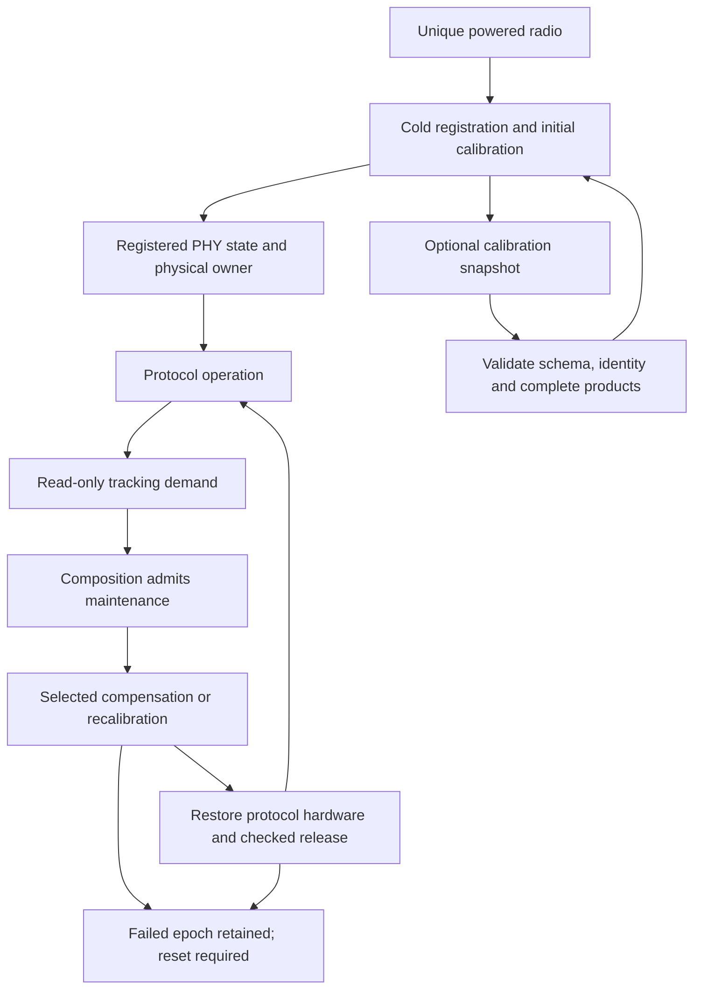
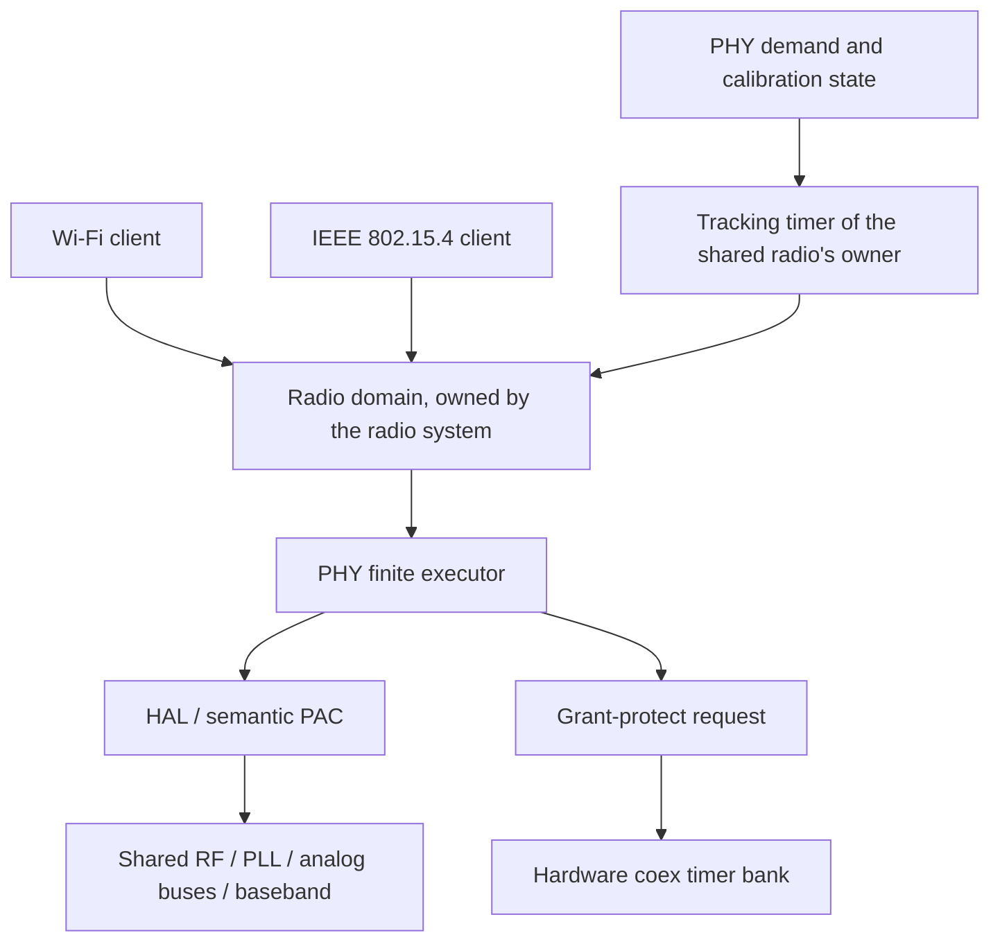
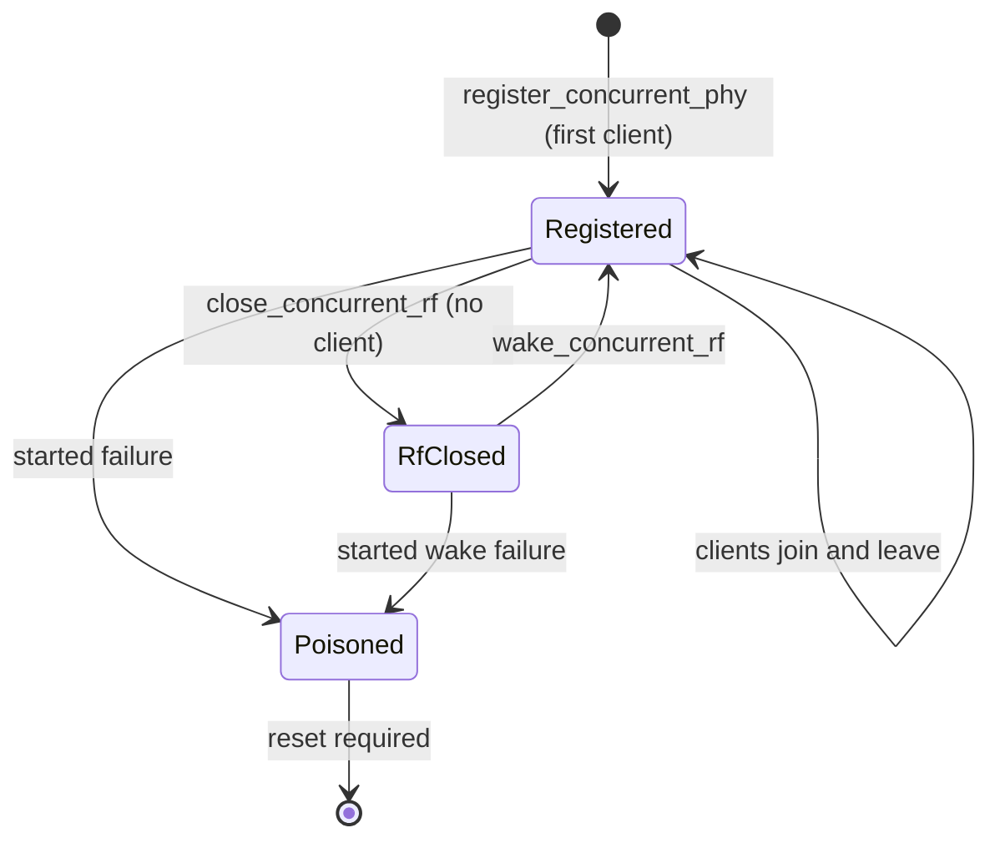

# ESP32-S31 PHY architecture

This crate owns S31 RF algorithms, calibration state and finite hardware
transitions. It consumes typed HAL operations; it does not link the vendor PHY
library. Protocol runtimes own their MAC, descriptors, interrupt routes and
connection state. The radio system owns the shared radio domain and serializes
PHY lifecycle, retune and tracking calls through exclusive ownership.

The [capability matrix](FEATURES.md) distinguishes implemented primitives from
composed services. The [tracking contract](src/tracking/README.md) is the
canonical reference for demand, admission, cancellation and restoration.

The opt-in `lifecycle-fault-injection` feature exposes destructive one-shot
checkpoints in real maintenance. It owns no timer, reset mechanism or transport;
the caller must provide independent termination. Default builds omit its code.

## Terminology and phases

| Term | Meaning in this module |
| --- | --- |
| Initial calibration | Measurements and hardware setup performed during cold registration, before a protocol receives its operational radio owner. |
| Calibration results | Retained measurements and derived configuration. Having these values does not prove that hardware currently contains them. |
| Restore / replay | Re-establishing hardware from retained results after an invalidating power/reset transition. It is distinct from measuring new results. |
| Runtime tracking | The service of observing operating conditions, deciding which RF parameters need attention and executing admitted updates. It is an umbrella term, not a PLL-only operation. |
| Compensation | Computing and publishing an adjustment from an existing calibration model, such as temperature-dependent power/gain or analog-I2C band selection. It can still change hardware used by active traffic. |
| Recalibration | Repeating selected measurements or searches, such as common DCODE/RX gain or class TXDC/PWDET calibration. It does not necessarily repeat the full cold graph. |
| Maintenance | The execution interval and ownership transaction around tracking or another disruptive PHY operation. Demand for maintenance is not permission to execute it. |
| Packet reception adaptation | Per-frame AGC, carrier/frequency correction and channel estimation in the receive path. These are not the runtime temperature-tracking scheduler. |

RFPLL capacitor correction is named by its actual operation; it must not be
confused with complete frequency initialization or a proof of PLL lock.
Likewise, restoring MAC baseband enable is not restoring a protocol's DMA,
interrupt or connection epoch.



[Registration](src/calibration/registration.rs) admits a cache only when its
schema, physical identity, completion guards and RX table shape match. A valid
snapshot restores semantic calibration products and selects partial cold
calibration. The ordinary RF/baseband graph regenerates frequency memory and
republishes RX and TX gain state that cannot be assumed to survive a cold
epoch. An invalid or incomplete snapshot selects `FullAfterRejectedCache`.
Persistence belongs to the caller. Runtime tracking is not a substitute for
reset or retained-sleep wakeup replay.

## Owners and dependencies

| Owner | Responsibility | Boundary |
| --- | --- | --- |
| [Calibration](src/calibration/registration.rs), [analog](src/analog.rs), [RX](src/rx.rs), [TX](src/tx.rs) | Finite measurements, searches, ordered hardware actions and their results | No network sockets or protocol scheduling policy |
| [PHY state](src/state.rs) | Configuration, calibration results, temperature references and cache values | Values do not grant register access |
| [Client state](src/state/client.rs) and [tracking schedule](src/tracking/schedule.rs) | Active clients, source intervals and read-only demand | Wi-Fi and BT/154 are scheduling classes; BT and 154 remain distinct clients |
| [Registered domain](src/domain.rs) | One `PhyDomain` per registration: calibration state and the shared client set | A domain cannot be cloned, rebuilt or paired with another epoch; operations check the registration epoch before hardware access |
| [Concurrent domain](src/concurrent.rs) and its [target port](src/target_port/concurrent.rs) | The shared domain in the HAL radio domain; Wi-Fi, Bluetooth and IEEE 802.15.4 join it as clients | Lifecycle and tracking consume the radio domain and return it with their typed result |
| [Tracking graphs](src/tracking.rs) and [executor](src/executor.rs) | Execute selected children and validate their completions | No independent RF arbitration |
| [Target port](src/target_port.rs) and [HAL PHY](../hal/src/phy.rs) | Typed MMIO, analog buses, hardware completion and bounded waits | Hardware access is borrowed from the admitted owner |
| [Analog register bus](../../espressif/analog/README.md) | Field, configuration and parallel transitions of the vendor analog-I2C leaves | The transitions touch no bus; the target port and HAL drive them |
| [Radio system](../radio/system/README.md) | The radio domain, platform resources, first-join registration and deadline-driven periodic tracking | The P2 actor transfers an owned PHY transaction for tracking with grant-protect brackets; it pauses no protocol |
| [HAL stopped-MAC check](../hal/src/owner/maintenance.rs) | The stopped Wi-Fi MAC check at the final-client boundary | A CPU mutex does not stop MAC or DMA |
| [Hardware coex control](../../espressif/coex/README.md) | Recovered timer requests, PTI, clock conversion and withdrawal accounting | Programmed timer identity is not an RF grant |



PHY supplies the algorithms, demand and the concurrent domain. The radio
system owns that domain and runs registration and tracking in its P2 actor;
coex supplies the hardware arbitration mechanism. Exclusive ownership of the
PHY transaction serializes its register access. Tracking brackets RF-sensitive regions with a
grant-protect request instead of pausing protocols. `admit_maintenance` checks
pending tracking state, without a hard-window calendar or grant acknowledgement.
A coex timer reply, client bit or PTI is never an ownership proof for the shared
PHY, and the request bracket does not prove exclusive RF access.

The Wi-Fi airtime scheduler selects packet service within a MAC epoch. It does
not own the shared RF resource and cannot independently admit PHY maintenance.

## Power lifecycle boundary

Client bookkeeping and physical RF power are separate state transitions. The
last client leaving keeps RF, analog state and shared clocks physically
powered until the radio system closes RF; a closed domain admits no client
until it is woken.



RF close runs the current-vendor pre-close temperature observation and the
complete finite `phy_close_rf` graph: it disables hardware frequency control
and AGC, closes the RF and frontend/baseband domains
and publishes both retained analog close images. A preparation failure keeps
RF open; failure after close begins poisons the domain.

Retained wake executes the complete current-vendor wake parent in recovered
order without retiring the registration epoch: frontend/baseband and
analog-I2C power, retained frequency publication, channel and TX-cap state,
PBUS boundaries, PHY and AGC register updates, CKGEN reset, then restoration
of hardware frequency control, BBPLL, force-TX/RX and baseband mode. Every
started failure poisons the domain.


### Concurrent clients

For concurrently running protocols the registered domain lives beside the
shared registers in `RadioDomain<B, ConcurrentPhy>`. Registration, tracking,
RF close and retained wake consume that domain and return `(domain, result)`.
`RadioDomain::detach(operation)` produces one owned `RadioTransaction`; its explicit
reunion preserves registration epochs and pending restore obligations. The
transaction can split into an inert return owner and a movable
`PhyTransaction` carrying the hardware and grant-protect state. A split
reunion rejects another domain's transaction without consuming either
payload. The domain identity is affine and permanently claimed: equal
registration epochs do not authorize a foreign return. Successful reunion
consumes both halves, so a stale return token cannot remain live.

Registration, RF wake and RF close construct their async state directly in
their enclosing place and use the same `executor::boundary::Boundary` as
the radio actor. Registration transfers typed `Placed` custody between retained fields;
its constructor detaches the owned transaction before the first poll.
Owned lifecycle futures pin their borrowed PHY children in their retained
state and await pinned references. The radio backend pins the owned
operations in the same way. Completed child results remain in placed fields
of that retained state; only their exclusive `Placed` loans cross the poll
boundary. Reunion and backend return handling consume those loans in separate
non-inlined functions, keeping whole result temporaries out of poll frames.

Dropping either half, or a pending lifecycle/tracking future even before
its first poll, quarantines all payloads without dropping their owners or
restoring registers. Its named fault retains the cancelled operation
and registration observation. Both halves report the same operation,
independently of drop order. Firmware binds the fault directly at link
time through the HAL's `phy_fault_reporter!` macro to the chip composition's
`phy_fault::reset` (`oer-esp32s31-compose`), which calls `fatal::reset_recording`;
a 16-byte record naming the operation and epoch is printed on the next
boot and cleared only after successful output. Host tests use an independent
seat and catch their own never-returning reporter. There is no lock, unsafe
borrow extension or automatic rollback.

Client membership uses short exclusive borrows. Channel capabilities borrow
from an owned transaction: selection and retune retain its cancellation guard
across every await.

The production operations are:

- `register_concurrent_phy` registers the domain once through the domain's
  owned PHY transaction. As ESP-IDF's calibrating first `esp_phy_enable`, it
  enables the `PHY` and `PHY_CALIBRATION` modem clock modules through the
  domain and releases `PHY_CALIBRATION` after calibration;
- `close_concurrent_rf` runs `phy_close_rf` after the last client left and
  releases `PHY`, as the last `esp_phy_disable` does. `wake_concurrent_rf`
  takes `PHY` and `PHY_CALIBRATION` again, restores the retained
  registration by `phy_wakeup_init` without calibration and releases
  `PHY_CALIBRATION`. A closed domain admits no client;
- `acquire_client` and `release_client` enter and leave Wi-Fi, Bluetooth and
  IEEE 802.15.4 as clients of the one client set;
  `wifi_client::join_wifi` and `leave_wifi` do this for Wi-Fi on the HAL's
  clocked Wi-Fi owner (`esp_phy_enable`/`esp_phy_disable(PHY_MODEM_WIFI)`),
  as `ieee802154_client` does for IEEE 802.15.4 and `bluetooth_client` for the
  Bluetooth Controller's task owner, each with its BTBB reference;
- `select_concurrent_wifi_channel` and `switch_concurrent_wifi_channel` tune
  the shared domain for Wi-Fi through the HAL Wi-Fi client's channel HAL,
  which it lends together with the domain's attachment; the switch stops and
  restarts the Wi-Fi MAC around the retune;
- `evaluate_periodic_tracking` and an acquisition that needs initial tracking
  leave the domain pending, and no client operation proceeds until it settles;
- `admit_maintenance` checks, without register access, that tracking is
  pending, and `maintain_concurrent_phy` then runs the tracking transaction;
  a started failure poisons the domain. The one admission follows ESP-IDF's
  `phy_common.c`: the periodic timer runs `phy_param_track_tot` under the PHY
  lock alone, without pausing any protocol. The owned PHY transaction is that lock,
  and the tracking graph brackets its RF-sensitive regions with the
  grant-protect request. A protocol operation that loses RF to it ends with
  its ordinary outcome.
- `track_concurrent_phy` is one tick of the vendor `phy_track_pll`: it
  evaluates the clients' tracking period and runs due tracking at once. The
  radio-system actor calls it when its deadline timer wins against its
  request doorbell, while tracked membership exists.

### First and last PHY client

The owner of the shared radio chooses the PHY transition for a joining
client as the vendor `esp_phy_enable` does, on the radio domain:

- RF closed: `wake_concurrent_rf` (the retained registration is restored
  without calibration);
- a client set already exists: nothing, the domain is already open;
- otherwise: `register_concurrent_phy` with the retained calibration cache
  when one was handed over (`PhyRegisterConfig::with_calibration_cache`), else
  a calibrating registration; a registration refused as
  `ConcurrentPhyError::AlreadyRegistered` counts as already open.

A client then proves the domain ready (`phy_ready`) on the radio domain it joins
with. Wi-Fi prepares the domain before it enters power, which a cold RF
restart requires. The last client's half of `esp_phy_disable` closes
RF (`close_concurrent_rf`) only when the domain is open and its client set is
empty; a `ConcurrentRfError::Recoverable` failure keeps RF open, any other
started failure requires reset.

IEEE 802.15.4 composes these steps in [its client module](src/ieee802154_client.rs).
`join_ieee802154` runs on the HAL `Ieee802154Clocked` owner and consumes a
`PhyReady` proof (`phy_ready`: the domain registered, RF open and settled,
its registration describing the domain, which the proof borrows until the
join gives it back); every client's entry into the client set consumes one,
so no client enters a domain that is not ready. The 802.15.4 and Bluetooth
joins prepare the client clock evaluation without changing its bits, timer
obligation or timestamps. They publish the retained registration's gain and take
BTBB before infallibly committing that evaluation. A refusal returns the prior
client owner; no fallible rollback from Pending is needed. A due commit returns
`TrackingDue` together with the affine membership and BTBB reference, and the
caller runs `maintain_concurrent_phy` before using RF. Wi-Fi uses the same
prepared pure client acquisition without BTBB. IEEE 802.15.4 issues an affine
`Ieee802154PhyMembership`.
`RegisteredIeee802154Operational` keeps the membership beside the operational
MAC owners; they return through a foundation readback, not a policy readback,
because the operational MAC rewrote the PIB. `leave_ieee802154` releases the
client and the BTBB reference, neither with register access.

IEEE 802.15.4 stays a PHY client while it sleeps. On the ESP32-S31 the
vendor `ieee802154_rf_disable` closes RF only together with the REGDMA PHY
retention (`esp_hw_support/lowpower/port/esp32s31/sleep_phy.c`), whose I2C
burst the pinned `libphy.a` does not provide
(`phy_ana_i2c_master_burst_rf_onoff`); without it the vendor keeps RF open
for the client's lifetime. RF closes only when the last client leaves.

Protocol runtimes must first return their real TX, RX DMA, IRQ, MAC/LL and
per-protocol receive-enable owners to the radio system. Consequently neither
`PhyClientState::release`, a zero client mask nor a coex request can call the
physical close transaction on its own. Failure after close begins poisons
the domain; the radio then requires reset.

## Conditions and cadence

[Registered-policy inspection](src/tracking/inspection/README.md) reports
scheduling demand separately from the current RFPLL, power, analog-I2C and
common/class calibration conditions. It makes no MMIO calls. Runtime sensor acquisitions have monotonic
start/end provenance; undated replacements invalidate that provenance. A due evaluation is not an instruction
to perform all heavy calibration. No hourly/daily calibration schedule or
qualified maximum thermal deferral is implemented.

## Runtime sequence and timing

A completed common RX calibration carries
[`PhyRxGainDcQuality`](src/rx/gain_calibration/quality.rs) alongside its
coefficients. It identifies convergence for every shared/Wi-Fi baseband gain
and the five `phy_rxdc_fine_cal` radio searches after Wi-Fi gain zero.
Exhausting a baseband search retains its initial pair; fine searches retain
their last correction. These vendor-compatible outcomes complete the transaction,
but do not mean every search converged. Completion flags describe lifecycle;
quality remains a separate result. A skipped DC branch has no new quality.

The source-derived tracking graph contains optional RFPLL work, BT/154 power
and class calibration, Wi-Fi analog-I2C/power and class calibration, followed
by temperature sampling. Decisions in this graph use retained temperature;
the final sample must not be interpreted as the input to every preceding
decision. Temperature sampling can itself adjust the sensor's analog range.

Read-only demand neither advances timestamps nor refreshes calibration results.
`Schedule::At` supports an absolute timer; `Schedule::Inactive` requires none.
Deferral retains the outstanding due instant. The execution path re-observes
the active clients, and only matching child completion commits branch results.
The source interval is not a measured maximum thermally safe deferral.

Constructing the [radio-system actor](../radio/system/src/lib.rs) does not
calibrate. Its first client `join` calls [backend `prepare`](../radio/system/src/esp32s31.rs)
→ `register_concurrent_phy` → `PhyDomain::register` →
[`run_phy_register`](src/executor/run.rs) after the P2 executor starts.
Registration runs the cold graph or its admitted cache path. A later join
after RF close restores the retained registration through `wake_concurrent_rf`. Initial client `track`
settles pending maintenance before operational use.

Periodic tracking runs in that same actor: after draining client requests,
it waits on the request doorbell versus `tracking_deadline` while a tracked
member exists. A timer win calls `track_concurrent_phy`, evaluates demand and
runs due work. The [client scheduler](src/state/client.rs) defaults to
1,000,000 µs; the strict due predicate selects `previous + period + 1 µs`.
Requests can postpone the tick; no one-period maximum deferral or shift counter
is enforced. The actor serializes
its own retunes but checks no granted hard-window calendar. `EmbassyClock`
uses the executor's SYSTIMER timer service: Alarm0 at P3 acknowledges and pends
P2, which dispatches timers and polls tasks. The direct maintenance
TXDC/PWDET path has a separate SAR/PWDET timer handler at P2. Wi-Fi images declare an actor task; B0 polls the attached actor inside
its P2 driver task, and the PHY diagnostic image drives concurrent PHY calls
directly from P2.

The parameter-tracking graph selects individual operations internally; no
protocol selects them as independent maintenance transactions. Joint
Wi-Fi/Bluetooth/154 maintenance and active-traffic publication of individual
compensation classes are not qualified execution modes.

The RX-gain path retains one [`RxProgram`](src/rx/program.rs) in both cold
registration and common tracking. Borrowed typed step tokens carry each
hardware command directly to one poll loop; consuming a completion updates
that same cursor and coefficient bank. Short ready leaves share a bounded
poll, while an incomplete DC/IQ observation waits on the caller's timer.
Other required 1–20 us hardware settles count machine cycles through `oer-riscv`,
using the stable frequency adopted by the HAL clock owner at runtime handover.
PBus/I2C leaves retain their bounded direct observation policy.
TXDC/PWDET retains its direct search/root interpreter inside the owned PHY
transaction, without CPU-admission queries between its direct operations. Each runtime SAR/PWDET conversion uses the explicit [step machine](src/tx/sar.rs)
and [affine timer service](src/sar_pilot.rs), with no future polled for its
hardware progress. The actor submits `PhyTransaction`, TIMG0's program owner,
the binding proof and machine through a one-slot queue. `DetachedRadioDomain`
stays in the waiting future, retaining cancellation and clock obligations;
calibration state is outside the transferred hardware half. Between events
the handler retains the active bundle in its own cell. Completion returns it
through a one-slot queue and a same-level `IrqSignal<InterruptExecutor<2>>`
declared with `FromExecutorLevel`. The leaf still suspends asynchronously at
its submission boundary: `Client::sample` has one `poll_fn` to validate/register
the executor context and one to wait for the reply. The async leaf-step count
is unchanged: the reply wait replaces the readiness-timer wait.
The table permanently binds TIMG0's interrupt owner as `Exempt(ExecutorLevel)`.
Startup masks and CLR-clears old RAW; the handler acknowledges each event
before rearming. Rearm does not acknowledge old pending. The measured S31 P2
pair assigns FROM_CPU2 line 17 ahead of TIMG0 line 16; other pairs/levels are
unqualified by that measurement. P1 entries use 40–42, retaining their order.
Each event performs one bounded I/O atom. The vendor's tone/trigger minima
are 1/2 µs. The machine returns those fixed relative intervals after tone arm
and SAR trigger; the handler reloads them after the edge without subtracting a
second clock reading. Crossing a microsecond boundary between the edge and
rearm cannot shorten either interval. Handler lateness and programming overhead
lengthen the wait; no upper latency bound is claimed.
An acknowledged event without a request or active bundle returns
`Err(SarAlarmWithoutBundle)` with the sampled RAW/ST and both queue lengths.
All owners remain held; the image immediately retains the reason and resets
through its existing direct call, without further service. Cancelling
the waiting lifecycle future records its admitted operation; an in-flight
alarm remains quarantined until reset, while completion already stopped/masked
it before publishing the reply.
Readiness retries rearm TIMG0 for 1 µs under our 40 µs engineering limit;
the ROM reference supplies no readiness deadline. Other PHY children,
including cold registration's existing graph bindings, remain async. The
handler does not call cooperative admission or a task waker. The current P2
executor round and P3 work can delay it; continuous higher-line P2 work can
starve it. RF quality, SRAM/stack cost and service latency for this pilot are
unqualified; the virtual-time tests establish ordering and minimum waits. A sample that reads ready
succeeds at any time, even after a late wake-up; the deadline bounds only the
not-ready case.
Interrupts remain enabled and the physical owner remains held until terminal
restoration. Longer registration, tracking and lifecycle operations wait on
the caller's `oer_time::Timer` through `executor::wait::delay` and its
`executor::wait::Kind`.

Direct PBus, analog-I2C and TX-DC/PWDET status observations use a named
20 µs elapsed-time budget on the caller's clock, including a final observation
after the limit is seen. This is a readiness policy, not a minimum delay or a
20 µs bound on a whole transaction. W2 measurements on s31-a exercised thermal
calibration, RFPLL tracking and retained RF wake; the longest direct edge
was 2,976 cycles at 160 MHz (18.6 µs). Timeout remains a typed failure.
The retained-wake frequency-ready edge already belongs to an asynchronous
transaction and retries through the timer in 10 µs steps.

The final temperature child of parameter tracking uses the private
[`executor::step`](src/executor/step.rs) transport driver. Its read, masked
read/modify/write and sensor-code atoms share the driver's cooperative batching.
The first bus completion sample follows a 1 µs timer backoff; not-ready retries
use the caller's timer. This retry cadence is separate from a vendor minimum
settle. T7's named answer window is our 100 µs budget from completed command
publication. The bus is sampled before judging the deadline: a completed
answer is accepted even after a late resume; only a still-busy bus times out.
The existing temperature graph owns conversion, range writes and dated commit.
Cancellation leaves the admitted PHY poisoned until reset.
At `Runnable`, the driver continues while CPU admission allows; otherwise it
self-wakes and returns `Pending` without a timer. A future `WaitAt` constructs
and polls the timer; an already reached `WaitAt` still yields once before
another hardware step. The gap between RMW commands has no command in
flight; its first busy-at-start attempt establishes that phase's bound.

Wi-Fi temperature-band tracking (T3) uses the same P2 driver and counted I2C
cursor as cold RFPLL. The two masked writes retain their order, sampled bytes
and exclusive analog owner across `Pending`; only completion of both writes
allows the retained band to commit. These counted commands keep their original
`HARDWARE_EDGE_LIMIT` and first/repeated 1 µs observations. Their scheduler
pauses are not charged against a direct-path elapsed settle. The diagnostic
hold reports T3's engine polls as family 3 after the tracking root returns.

The diagnostic hold reports aggregate engine poll count/total/maximum, timer
resume lateness, and maximum command-to-ready time. Counters are fixed local
fields; reporting follows root return and performs no UART work inside any
measured interval. Count
or duration overflow invalidates the evidence. These observations cover this
transport path; the remaining tracking families retain their existing execution.
The initial IEEE 802.15.4 maintenance also retains a bounded local trace of
command-to-first-check time, each not-ready check, resume lateness and elapsed
time at failure, plus count/total/maximum of voluntary yields without a timer.
On a late failure it samples both host busy bits without
consuming the rejected result. The diagnostic reports this trace after
maintenance returns; an unobserved ready edge has only a time interval.

CPU admission is checked only in the [shared transport](src/executor/step.rs)
and [RX-gain](src/executor/rx.rs) drivers, between complete atoms. The
[executor's `should_yield`](../../espressif/executor/src/executor.rs) accounts
for ready tasks, the executor's pending software interrupt, the radio doorbell,
unserviced typed signals and the current task poll's elapsed time. The drivers also stop admitting atoms
when their local batch reaches 900 µs. Per-command RFPLL tracing yields at each
checkpoint. The 50 µs atom and 1 ms poll limits are cooperative contracts:
there is no timer that interrupts an overlong atom or enforces them throughout
every parent future. Direct TXDC/PWDET and the cold registration parent have
no admission checks of their own; immediately ready children can chain in one
poll. The executor round can include several task polls.

The timing mechanisms have different scopes:

| Mechanism | Meaning | Enforcement / limitation |
| --- | --- | --- |
| Vendor minimum settle | Wait at least the required time after a hardware action | Named 1–20 µs settles use `mcycle`; longer settles use the caller's timer. Preemption can lengthen them. |
| Readiness deadline | Our bound for observing completion or giving up on busy hardware | Direct observations use 20 µs; T7 accepts a completed answer after its 100 µs busy window; SAR gives up after 40 µs without a ready sample and accepts any ready sample. These are not vendor maximum delays. |
| CPU admission | Decide whether another complete atom may run | Stop at a ready peer or 900 µs admission threshold, reserving 100 µs toward the 1 ms contract. No universal atom/poll elapsed-time cutoff. |
| RF admission | Decide whether the shared RF transaction may start | Pending tracking state and the owned PHY transaction; grant-protect brackets request hardware arbitration. No hard-window calendar, grant proof or one-period deferral bound. |

Finite execution limits are separate from those timing mechanisms:

| Mechanism | Established bound | Limitation |
| --- | --- | --- |
| [Direct bus polling](src/executor/wait/poll.rs) and [target executor](src/target_executor.rs) | Finite observations per PBus/I2C operation; typed failure on exhaustion | Requires each MMIO access to return; nested operations have separate observation budgets |
| [DC/IQ estimator](src/calibration/estimator.rs) | Finite readiness samples, then measurement/start cleanup on missing-ready | Cleanup and settle calls must themselves return |
| [Calibration executor](src/target_port/calibration.rs) | Root operation accounting and finite gain-state loops | Operation counts do not bound IRQ interference or a stalled bus access |
| [RFPLL search](src/tracking/rfpll/search.rs) | Both search directions terminate after finite samples, including unrecognized status values | Its finite state graph still invokes synchronous bus and settle operations |

The BLE radio owner arms the independent SoC deadline service around
physical lifecycle transactions and keeps the radio domain until checked restoration.
The board/application supplies explicit engineering budgets; PHY owns no timer
or reset peripheral. Hardware reset does not by itself establish a qualified
RF-cessation bound. A pending-future timeout, observed calibration maximum and
finite loop count cannot establish that stronger guarantee either. Failed or
expired work cannot manufacture runnable ownership.

Timing qualification must cover the complete action-to-hardware path, including
executor-added waits, readiness retries, failure cleanup and the selected
runtime adapter. Every wait of at most 100 us requires hot-path classification,
with waits of at most 20 us reviewed first. Record the required minimum,
first-read placement, retry predicate and bound, implementation mechanism, and
measured elapsed time separately. Include variable-duration waits whose range
can enter this interval. A compiled semantic comparison alone does not qualify
these timing properties. Vendor references must include the linked firmware
and its ROM callees: ESP-IDF can override archive leaves, including the I2C
critical-section hooks. Code-placement comparisons require an aligned wait
baseline first.

CPU waiting time, RF exclusion and unavailable packet service are different
quantities. Async hardware waits can release the CPU while the radio remains
unavailable. The current executor uses bounded hardware observations where
there is no owned completion interrupt. Moving those observations to a timer
does not make a long calibration harmless to traffic.

RX-gain host oracles exercise the same program and pure search arithmetic as
production. The frozen leaf/outcome projection exists only in tests;
hardware vendor comparison runs the real program through the validation owner.
There is no per-leaf child future or nested RX action/binding/completion path.
Every DC/IQ estimator
consumes the same root operation budget, while the fixed outer calibration
graph has its own finite structural bounds. Budget exhaustion cannot produce a
complete coefficient set, and failure retains the recovered cleanup and
outer-control restoration sequence.

The fixed bank encodings are generated at compile time and shared as read-only
data. Measured DC coefficients remain in the individual transition, and entry
encoding borrows them. Terminal products are inspected separately from hardware
admission. Compile-time budgets cover both retained transitions and the compact
external bindings that cross executor call boundaries.

RX diagnostics record only the root interval, its single-poll execution, three
disjoint direct phases and clock-free path counts. They do not install callbacks
inside the minimum-search loop. Search traces and elapsed hardware timing
remain separate measurement scopes.

## Measured RF hold of a tracking tick

The quiet diagnostic observer measures the production concurrent tracking path
on ESP32-S31 s31-b. Source `d17da114` is based on main `4a02b652`; the production
PHY is unchanged. Each forced suite is three fresh boots of five due ticks.
Debug policy `(3, 0)` and the diagnostic retained-state forcing exercise RFPLL,
common and transmit branches on every tick. Wi-Fi also exercises both
retained-temperature-band I2C writes. All 30 ticks commit bitmap 7, restore the
saved policy and close RF.

Callbacks record coarse edges, root polls/suspensions, aggregate engine timing
and gain timing in bounded local storage. All diagnostic formatting and UART
follow the root future's return, including failure reports. Per-command RFPLL
tracing is disabled to match this quiet measurement method. The same observer
serves forced and natural policy; production w0–w2 contain none of it.

Values below are observed maxima in milliseconds, including interrupts and
observer overhead. Each column can reach its maximum on a different tick.
Baseband max is the longest individual off window; baseband sum is the maximum
sum of all off windows within one tick.

| Receiving client | Run id | RFPLL | Common | Transmit | Baseband max | Baseband sum | Whole Tracking |
| --- | --- | ---: | ---: | ---: | ---: | ---: | ---: |
| IEEE 802.15.4 RX, channel 15 | `1792681755048-003edfbd` | 4.838 | 11.214 | 10.425 | 10.275 | 18.160 | 25.443 |
| Wi-Fi RX, channel 1, unassociated | `1792681802053-003f0230` | 4.823 | 10.111 | 11.866 | 11.716 | 19.433 | 27.219 |

Reproduce these suites with:

```console
cargo hil --owner phy --board s31-b run --chip esp32s31 --repetitions 3 phy-tracking-hold-ieee802154-idle
cargo hil --owner phy --board s31-b run --chip esp32s31 --repetitions 3 phy-tracking-hold-wifi-idle
```

`phy-tracking-hold-wifi-ordinary` selects natural policy and records 20 bounded
batches of 16 ticks under one RF registration. It leaves debug bytes and
retained power/I2C state unforced, validates actual committed branch subsets,
and checks unchanged policy at every batch stop. Run `1792681870641-003f998f`
completes all 320 ticks and final RF closure with the same quiet observer. All
320 committed bitmap 0; no calibration branch was triggered in this idle sample.

These are idle observations with no generated associated-station traffic.
Tracking, grant-protect and baseband-off intervals are nested wall times;
root poll time includes interrupts, and suspension is the directly measured
Pending-to-next-poll gap. They are not exclusive CPU times. A grant-protect
bracket measures how long its request is programmed, not continuous RF exclusion
or receive blackout. Finite maxima do not establish a worst-case guarantee or
admit hard BLE windows; traffic and delivery effects require separate evidence.

## Restoration and failure

The physical operation owns register access across all nested waits. The
protocol retains packet storage, DMA leases and its paused runtime. MAC or
baseband writes inside calibration cannot manufacture a resumable protocol
epoch. Release checks and the exact RX/IRQ handoff establish that boundary.

A pending demand wait is cancellable without starting hardware work. An
abandoned consuming execution quarantines its owners and records a named
fault before reset. A failed execution returns its poisoned domain and
typed failure, without automatic rollback. Restoration failure also requires reset. Holding
a CPU critical section across async waits is not the exclusion model.

Calibration completion, restoration completion and measured RF quality are
distinct outcomes. The existing branch flags establish the first, while
protocol restoration establishes the second. Neither proves EVM, calibrated
radiated power, sensitivity or sustained thermal stability.

## Vendor reference scope

The runtime parent order and combined RX/TX transaction follow the pinned
esp-phy-lib `libphy.a` of `chips/esp32s31/vendor/artifacts.toml`.
RX has its own temperature reference; TX uses one shared reference and retains
separate Wi-Fi and BT/154 calibration results. Authenticated parent-boundary
execution checks call order and arguments with explicit child models. Compiled
comparisons additionally execute actual archive/ROM children for combined
calibration and the whole parent, including an RFPLL-enabled validation profile.
They compare semantic state and ordered effects under modeled peripheral inputs
and documented transport/wait projections; they do not establish RF quality,
hardware timing or live radio admission. See the
[tracking contract](src/tracking/README.md).

ESP-IDF's [open orchestration](https://github.com/espressif/esp-idf/blob/4d80c1b29aeabc8e735ffc6e1be9bb23e95d1d5d/components/esp_phy/src/phy_common.c)
calls a binary parameter-tracking function from a periodic task timer and on
eligible PHY enable. Its result flags describe selected branches, not a
hardware quiet-window contract. The library's grant-hook names alone are not
evidence that the final firmware acquired exclusive RF access.

RX gain diagnostics retain coarse DC, table-publication and control/restoration
regions without per-edge timing. Minimum-search intervals are nested in the DC
region, including accepted estimator steps and waits. The three region totals
are disjoint; minimum and fine-step totals must not be added to them. Observer
clock reads occur at region boundaries, so these remain instrumented durations,
not pure CPU costs. Early executor errors close active intervals as failed;
cancellation leaves incomplete evidence and does not release hardware ownership.

Coarse RX diagnostics additionally sample one in sixteen minimum invocations and
non-minimum DC executor steps, starting with the first. These sampled intervals
separate prepare/advance from MMIO, minimum settle and readiness execution.
Readiness time includes its timer and suspension, not just a register read.
Sampling is deterministic and may correlate with the search sequence; counts and
scoped maxima accompany totals, which are not whole-calibration costs.

The DC/IQ executor probes readiness immediately after measurement enable, as
rev0 ROM `phy_iq_est_enable` does, around the required 1-us start and stop
settles. Only a result that was not ready incurs the 1-us asynchronous
completion backoff; the observation limit and the timeout disable tail bound
the wait.
