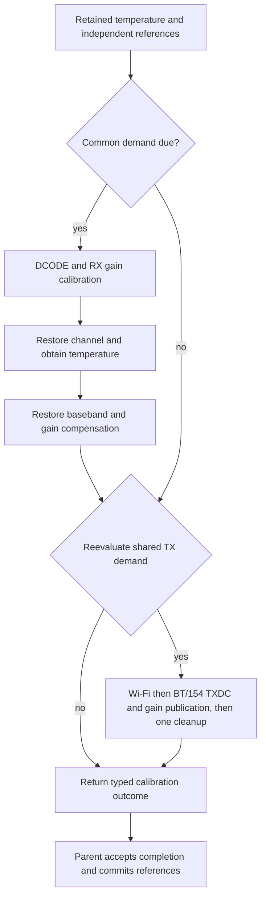

# PHY tracking contracts

See the [PHY architecture](../../README.md) for initialization, runtime
terminology and the ownership relationship with protocol runtimes and coex.

This module owns the source-derived tracking algorithms and read-only demand.
It does not grant RF access, stop protocol runtimes, or implement coexistence.
The registered domain and the shared PHY must remain in the radio domain
lease throughout execution. A network queue credit, scheduler pause or CPU
mutex alone is not permission to mutate the shared PHY.

## Inspecting conditions

The registered Bluetooth owner exposes `inspect_tracking(now_micros)`.
The [inspection contract](inspection/README.md) separates evaluation deadlines,
retained thermal conditions and physical admission. It reuses the executor's
predicates and does not replace its ordered, consuming decision process.

## Demand and execution

`PhyClientSnapshot::tracking_schedule_at(now_micros)` returns
`schedule::Schedule`:

- `Inactive`: no client requires a timer.
- `At(t)`: arm an absolute timer for the first due microsecond.
- `Due(demand)`: work is outstanding; hardware admission is still required.

Observation does not update source timestamps, temperature references or
calibration validity. Repeated observations after deferral retain the same
`due_since_micros`; they do not create additional execution obligations. This
instant reflects the source interval, not a measured maximum safe deferral.
BT and IEEE 802.15.4 share one tracking class but remain distinct clients.

Demand is copyable observation, not an ownership token. Re-observe the current
client set after waiting for admission: a client may have stopped while the
request was deferred. Do not execute an old copied demand as an RF grant.
The consuming `evaluate_immediate_tracking` transition retains its original
sample order and timestamp updates. It runs only when the caller commits to
execution; it must not be used merely to ask whether work is due. Its pending
owner remains pending until the selected target children complete.

The radio-system actor runs periodic tracking on P2 while tracked membership
exists. After draining requests it waits on its doorbell versus the backend's
tracking deadline; a timer win calls `track_concurrent_phy`, which evaluates
demand and runs due maintenance. The default period is 1 s, with eligibility
at `previous + period + 1 µs`. Initial client tracking also settles pending
work in this actor. Protocols are not paused; the tracking graph brackets
RF-sensitive regions with the grant-protect request.

CPU admission and RF admission are separate. The shared transport and RX-gain
drivers query cooperative CPU admission between complete atoms, using the
50 µs atom / 1 ms poll contracts and a 900 µs admission threshold. Those are
not universal elapsed-time cutoffs; direct TXDC/PWDET and parent loops do not
query admission between all operations. `admit_maintenance` checks pending
tracking state, and the exclusive mutable domain borrow serializes the
actor's tracking and retunes. Neither this check nor grant protection checks
a hard-window calendar or proves RF exclusion. Queued requests can postpone
a tick without a one-period deferral bound or shift counter. There is no
protocol-selected maintenance of individual operations. See the
[execution and timing scopes](../../README.md#runtime-sequence-and-timing).

## Operations and hardware effects

The following effects are implemented source operations. They are not a list
of operations qualified for concurrent radio use. Child operations are
ordered inside the outer transition; completing one child does not release
the outer owner's lease.

| Operation | Selection and effects | Commit / restoration boundary |
| --- | --- | --- |
| [Outer parameter tracking](parameters.rs) | Registered policy selects RFPLL, BT/154 power and calibration, Wi-Fi I2C/power/calibration, and temperature children. Inhibited policy skips hardware children. | Critical-section actions bracket the graph. The current target port acknowledges them logically; the caller supplies actual exclusion. Inhibited completion does not mean calibration data was refreshed. |
| [Power compensation](power.rs) | Computes a temperature decision; changed enabled gain publishes the selected class's gain through BBPLL calibration enable/disable edges. | Gain/temperature outcome follows the child and BBPLL tail. An unchanged decision does not publish gain. Live gain publication atomicity is not qualified. |
| [Wi-Fi I2C tracking](i2c.rs) | A temperature-band change executes two bounded masked analog-I2C writes. | The new band is committed only after both writes. No band change means no writes. The analog bus must have one transaction owner. Safe overlap with active TX/RX is not established. |
| [Temperature sampling](../analog/temperature.rs) | Reads PHY-I2C range and sensor code; may also write a new range. This is not an unconditional read-only operation. | The sensor transition carries matching completions. Concurrent sensor/range access is not qualified. |
| [Current measured RFPLL correction](rfpll/README.md) | Bounded capacitor search, signed correction of the installed frequency-memory table, and current baseband-mode entry/restoration. Production runs it as the RFPLL child of the parameter-tracking graph. | Registered tracking selects the thermal predicate. Compiled comparisons cover command/memory effects and vendor-policy boundaries; timing and physical range limits remain unqualified. |
| [Common calibration](calibration.rs) | A temperature threshold selects DCODE, RX-gain calibration and channel restoration. | The branch restores MAC baseband and TX gain compensation before committing the common reference or entering class calibration. |
| [Shared TX calibration](calibration.rs) | A shared TX threshold selects software frequency control, forced gain/TX-RX state, TXDC/PWDET and class gain publication. | The graph restores its baseband/control and gain-compensation state. This is not proof that every protocol's MAC, key, TSF or DMA context is unchanged. No selected branch means no hardware actions in this child. |

T2/T4 power tracking owns its child and `EngineTiming` inside the shared P2
driver. A safe enum separates timer/borrowed-transport storage from the
power route; power has no outer async layer or separate job. An atom executes
one BBPLL edge, one complete force/write plus its 1-µs settle, gain setup,
or one complete gain-memory record. The driver can batch runnable atoms while
CPU admission allows; a voluntary yield self-wakes without a timer, retaining
the RF/state borrow. A compact generator keeps
only arithmetic state and the next index, never a whole image. Both pinned
profiles select seed quartets within the seed portion of the unchanged
seed/output32 concatenation. The whole-image builders share the same arithmetic;
stream tests compare every encoded entry with the canonical packed image.
Clock-free preparation and acknowledgement stay outside the clock/accounting
shell. The shared driver decodes the action once per atom. Only after all 32
Wi-Fi or 16 shared records does the gain child acknowledge publication.
Terminal completion commits the semantic result after BBPLL-off.
In power-family engine observations, `ready_edges` and `maximum_ready_micros`
count and time gain setup and individual records; `maximum_micros` covers
the whole driver poll. Separate maxima cover lower/setup, one record's
arithmetic/encoding and its complete publication. Diagnostic holds force the
selected class's gain update and report family2 (BT/154) or4 (Wi-Fi).

Full cold registration and cache replay belong to
[calibration/registration](../calibration/registration.rs), not the periodic
scheduler. A serializable calibration snapshot does not certify hardware
restoration.

`PhyCalibrationTrackingParameters::decision()` is the single read-only
thermal decision used by the calibration transition. It exposes independent
RX and shared TX demand, their reference samples, absolute deltas
and thresholds in sensor units. Equality is due; a zero diagnostic threshold
forces both branches. It does not commit references, certify sample freshness
or provide RF authority. The common branch can obtain a new temperature during
channel restoration. TX demand is evaluated again after that restoration and
gain cleanup, so it can become due or cease to be due. An initial decision is
not an immutable list of jobs for an entire maintenance pass.

## Current parent and grant boundaries

The outer graph follows `phy_param_track_tot` in the pinned esp-phy-lib:

The combined calibration call keeps one RX reference and one shared TX
reference. When RX channel restoration replaces the sample, TX demand is
reevaluated against that sample. Selected Wi-Fi and BT/154 TX results remain
distinct; both complete inside one frequency/forced-gain envelope. Failure of
any requested child prevents terminal publication of the combined outcome.
Even a direct call with neither class selected can run the due TX envelope;
the normal scheduler admits work only for active clients. Each measurement
branch explicitly disables Wi-Fi baseband: after DCODE and before RX gain
calibration, or after TX PBus clearing and before calibration bandwidth setup.
This register operation is not a substitute for physical maintenance admission.

The vendor RX branch and shared TX branch each acquire and release grant
protection separately, as does RFPLL. The pinned `libcoexist.a` (`fa152b3b`)
provides strong hooks that request/release an event through the coex timer
engine. OER follows those brackets: the calibration and RFPLL transitions emit
`SetGrantProtect` at the same positions, and the target port executes them
through `PhyGrantProtectPort`. The radio domain lends one
`PhyGrantProtect` request beside the shared PHY, so
the request is programmed in every configuration, including Wi-Fi alone. The
hooks do not themselves wait for a grant acknowledgement or prove MAC/DMA
quiescence. OER retains the exclusive mutable radio-domain borrow through the
complete call; the current pending-state admission supplies no additional
hard-window or exclusive-grant check. A failed branch leaves the request
programmed with the rest of the poisoned epoch.

The vendor composition combines archive request/event mapping with ROM release
and timer operations. Its initializer installs the new mapper in the callback
table used by ROM release. The PHY request selects event 48, timer 5 and request
kind 2 (hardware selector 0), with zero timing arguments; the arbiter reserves
timer 5 for it and lends only timers 0 through 4 to the coexistence policy. Neither zero timing
arguments nor a successful return establish an indefinite or exclusive grant.
`coex_status_get` delegates to a software-state accessor; it is not a hardware
grant acknowledgement. A physical protection proof needs independent hardware
observations of active exchanges and release.

The physical grant request has no nested-acquisition count. The shared owner
serializes it; independent callers cannot manufacture separate grant leases.
MAC, DMA and peer reception require their own completion proofs.

A failed TXCAL cannot return a normal owner or publish partial calibration
state. Earlier completed power or RFPLL children remain committed; the outer
transaction does not roll back already executed hardware operations.

## Timing observations

[Observation](observation.rs) names outer tracking calls and expensive
calibration steps. The executor emits `Started` before awaiting the port and
`Completed` only after accepting its completion. Port errors or rejected
completions emit `Failed`. Cancellation emits no fabricated terminal event.
Default observers require no clock or storage.

The allocation-free recorder accepts caller-provided monotonic timestamps.
It retains attempt/completion/failure counts, total terminal duration and
maximum duration per operation. Nested durations are inclusive: parent and
child totals must not be summed as exclusive CPU or RF time. Clock reversal,
overflow or malformed event pairing marks timing invalid. A selected call can
complete without performing calibration; committed branch flags retain that
separate meaning.

DCODE, RX gain and TX DC/PWDET also expose poll count, total time inside polls,
maximum poll duration, the number of Pending returns, and total/maximum gaps
from a Pending return to the following poll entry. Each completed child has
one final Ready poll; cancelled children cannot manufacture that completion.
Gaps are measured within each invocation, never between successive invocations.
The target wraps the actual child future without
adding wakes, polls or timers. These intervals include interrupts and observer
overhead, so they are not CPU cycle measurements. Operation time minus poll
time includes suspension, executor scheduling and outer transition overhead.
The measured Pending-to-poll gaps exclude the initial poll-entry delay and
outer transition overhead, but do not reveal when the awaited hardware or
timer actually became ready. Neither these gaps nor the remaining time may be
labelled requested hardware delay or CPU idle time. The recorder
rejects malformed intervals instead of accepting them as a
successful measurement. Other operations have no poll breakdown.

The RF hold of a tick is timed as held intervals separate from the
operations nested in them:
- `GrantProtectRfpll`, `GrantProtectCommon` and `GrantProtectTransmit` run
  from each bracket's grant-protect set to its release, by the calibration
  branch the transition reports (`PhyCalibrationTrackingBranch`);
- `WifiBasebandOff` runs from `DisableWifiBaseband` to `EnableMacBaseband`.

A grant-protect interval is the time the request was programmed. It is not
an observation of RF exclusion. The debug-control class (`cfg(oer_debug_control)`)
lets a diagnostic image force branches through the vendor's
temperature-tracking debug policy
(`ConcurrentPhy::set_temperature_tracking_debug`), used by the forced
tracking-hold diagnostics.

Production RX gain retains one `RxProgram` cursor in cold registration and
common tracking, under the exclusive PHY owner. Typed step tokens carry its
commands to `executor::rx`; completed atoms can share a poll while CPU admission
allows. An incomplete DC/IQ observation waits 1 µs on the caller's timer and
returns `Pending`, even if that timer is immediately ready. Required short
minimum settles remain synchronous. Diagnostics record disjoint DC, publication
and control phases, plus clock-free search and settle counts. Host oracles and
vendor comparisons exercise that same program; there is no per-leaf future.

A PHY delay (`executor::wait::delay`) distinguishes minimum hardware settles
from bus-admission and readiness retry backoff. Named nonzero settles up to
20 µs use the synchronous short-delay backend, which counts `mcycle` at the
adopted CPU frequency with interrupts enabled. Longer settles and all retry
backoffs use the caller's `oer_time::Timer`, capturing the absolute deadline
when the wait is created. An elapsed timer deadline needs no wake registration;
a future deadline uses ordinary timer wake registration. These waits are not
cooperative execution budgets: several completed waits may permit more hardware
steps in one poll. The maximum
poll observation must therefore be considered independently of total pause time.

Diagnostic connected Wi-Fi keeps the recorder beside the parked runtime,
outside nested PHY futures. Callbacks borrow it briefly, with no borrow across
a wait and no formatted output. Successful pause reports include a snapshot.
Physical failures return their existing failure stage without a timing
snapshot. Diagnostics-off images have no timing observer.

## Physical ownership and errors

The vendor admission runs tracking with protocols active under the lease and
the grant-protect brackets. It does not establish that a smaller exclusion scope is safe for an operation
the vendor does not run that way. No active-radio operation is admitted based
only on its name or on a similar driver for another chip.

A CPU critical section does not stop DMA. The async target executor must not
hold a CPU critical section across timer waits. The outer owner instead
retains its exclusive radio-domain borrow until terminal completion or failure;
that borrow and the grant-protect request do not establish an RF quiet window.
A failed or abandoned tracking epoch cannot yield a ready owner without the
required reset/recovery.

A PHY operation may restore baseband enable bits. The caller must establish
its required postcondition after execution before publishing descriptor or
interrupt ownership. Existing `RxRingHalted` teardown rebuilds a new descriptor
epoch; it is not a transparent pause for outstanding upper-layer RX leases.

Source timestamps record the scheduler's execution request. They are not
independent evidence of RF quality, completed calibration branches or an
externally granted radio interval. Temperature-reference commits and typed
child outcomes remain the algorithm's completion authority.

`PhyParamTrackingOutcome::calibration` reports only committed common and
RX and requested TX calibration branches. Invoking a calibration child below its thermal
threshold leaves the corresponding flag false. Wrong-class or incomplete child
completions cannot publish this progress. These flags do not measure RF quality.

Runtime Dcode passes an explicit delay factory through both its direct PHY-I2C
bindings and its nested RFPLL frequency transitions. The report keeps three
nonoverlapping groups: direct I2C, RFPLL I2C and explicit RFPLL settling/lock
delays. Each group retains completed wait counts, requested microseconds,
elapsed microseconds and maximum deadline lateness. I2C groups also count the
subset of waits caused by a busy bus at command start; remaining waits precede
transaction-completion reads. These counts are not hardware-ready timestamps.

The timer adapter supplies the same start/deadline used for its own wait.
Events run after polling the timer; the completion timestamp is sampled before
recorder work. This avoids making a one-microsecond wait expire merely by
recording its start before polling. The observer and its state are local to the
maintenance invocation; no global active-operation identifier or extra wake
source is used. Overflow, unsupported timing or unmatched events invalidate the
report. The diagnostic count bound does not change hardware retry limits.

D-code visits Wi-Fi channels 1, 5, 10 and 14 through the frequency-table
switch path. Each switch waits for channel readiness and updates NRX once
before CKGEN reset and two D-code reads. It does not perform a full capacitor
search. Its RFPLL settle timing therefore describes channel-switch waits;
analog PLL locked/unlocked and RFPLL-I2C counters remain zero on this path.
Channel readiness is not an analog lock measurement. The standalone tracking
RFPLL operation remains distinct from these channel switches.

RX gain recalibration visits 2484 MHz through the initialized frequency table,
using the same table-selection entry as D-code. Direct synthesizer programming
remains a separate entry for cold frequency-table construction. RX gain does
not run a capacitor search merely because its input is expressed in MHz.

The RX-gain root retains newly measured per-gain DC and the five fine radio DC
pairs of `phy_rxdc_fine_cal` until both gain banks are published. Each Wi-Fi
entry selects the fine pair of its baseband-bit population, saturated at the
last code; the shared Bluetooth/IEEE 802.15.4 bank uses fixed baseband DC with
its own per-gain radio DC. The fine searches follow Wi-Fi gain zero, each
starting from the previous pair after its code is acknowledged. A timeout
cannot advance a search to measurement.

Every `phy_force_txrx_off_new` pair follows the vendor nesting count, which
production carries as a static `PhyForceTxRxDepth`: the common branch and the
TX envelope each enter at depth zero (force, then release), their nested
channel and gain children release by forcing again at depth one, and deeper
pairs touch no hardware. `phy_close_rf` does not force TX/RX. Parent semantic state is committed only after the
complete calibration child, including channel and baseband restoration.

The channel and runtime gain regeneration use the current S31 Wi-Fi coefficient
profile from `phy_wifi_get_tx_tab_new`, with provenance beside the source
constants. Wi-Fi adds its independent signed-byte adjustment to the gain base;
Bluetooth/IEEE 802.15.4 retains a separate subtractive attenuation input.
The Wi-Fi adjustment belongs to semantic Wi-Fi state and its calibration
snapshot. Gain calculation, calibrated coefficient selection and gain-memory
publication remain separate boundaries. Matching their effects does not
establish RF power accuracy or qualify the enclosing RXCAL/TXCAL parent.
The current archive initializes its additive adjustment to zero, but calibration
backup/recovery preserves it and init-parameter loading does not clear it.
Zero at startup is therefore not a lifetime invariant. The comparison exercises
restored synthetic values through the actual gain callback.
The production semantic state does not import this vendor calibration image.

The independent signed Wi-Fi gain adjustment survives runtime tracking and
snapshot replay. It is not a TXCAL result or a lifetime-zero invariant; RF-test
MAC power selection stays outside the tracking graph.

The TX-DC/PWDET child uses the current archive's Wi-Fi and BT/154 forms through
one bounded target executor. Its initial TX-on prefix includes the final
selector-five PBus command before SAR configuration, followed by separate
per-row path and baseband-gain settings. The child restores its retained
power-detector fields before publishing measured DC rows. These measurements
do not update the independent Wi-Fi additive gain adjustment.

Compiled comparisons cover ordered control effects and calculated rows under
modeled peripheral inputs. They do not qualify physical SAR accuracy.

Each tone-SAR conversion bounds unsuccessful readiness observations using
`HARDWARE_EDGE_LIMIT`. Exhaustion is `ReadyObservationLimit`, carrying the
measurement, sample and observation count; it is distinct from an externally
reported elapsed deadline and from the global executor operation limit. A
failed conversion cannot publish a measured sample. The enclosing TX-DC root
propagates this failure through its cleanup without publishing DC coefficients.

Runtime TX DC/PWDET reports five separate timer groups: PBus, search settling,
tone arming, SAR triggering and root setup/cleanup. PBus waits distinguish a
busy command start from waiting before a completion-edge read. SAR ready and
not-ready counters consume existing status completions. Repeated not-ready
samples are synchronous polls in the finite calibration executor, not timer
waits; these counters reveal that work without adding reads or changing retries.

RX gain and cold registration retain unobserved delay factories. Diagnostics-off observers do
not request deadline measurements. Lateness includes delay-future construction,
executor resumption, timer polling and timestamp sampling; it is not a pure
scheduler-latency measurement. Instrumentation still has a cost, especially
for microsecond waits. Wait times lie inside the enclosing operation/poll/gap
intervals and must not be added to those parent totals.
