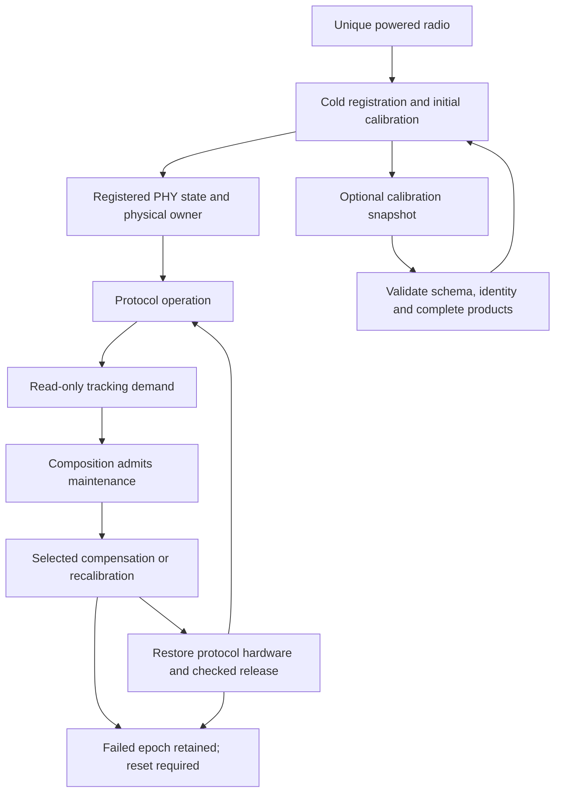
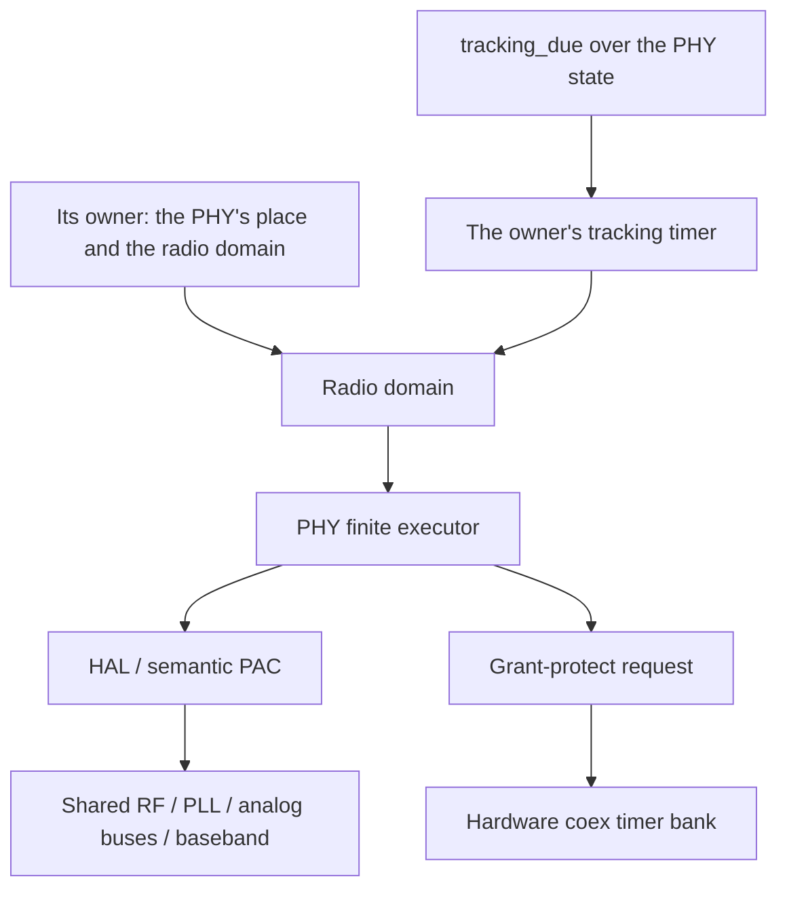

# ESP32-S31 PHY architecture

This crate owns S31 RF algorithms, calibration state and finite hardware
transitions. It consumes typed HAL operations; it does not link the vendor PHY
library. Protocol runtimes own their MAC, descriptors, interrupt routes and
connection state. In the built tree a probe holds the shared radio domain
and calls the PHY's lifecycle, retune and tracking itself; the radio system,
which owned the domain and serialized those calls, is a source outside the
build.

The [chip overview](../../README.md) links protocol and coexistence scopes.
The [tracking contract](src/tracking/README.md) is the
canonical reference for demand, admission, cancellation and restoration.

The opt-in `lifecycle-fault-injection` feature exposes destructive one-shot
checkpoints in real maintenance. It owns no timer, reset mechanism or transport;
the caller must provide independent termination. Default builds omit its code.

## Terminology and phases

| Term | Meaning in this module |
| --- | --- |
| Initial calibration | Measurements and hardware setup performed during cold registration, before a protocol receives its operational radio owner. |
| Calibration results | Retained measurements and derived configuration. Having these values does not prove that hardware currently contains them. |
| Restore / replay | Re-establishing hardware from retained results after an invalidating power/reset transition. It is distinct from measuring new results. |
| Runtime tracking | The service of observing operating conditions, deciding which RF parameters need attention and executing admitted updates. It is an umbrella term, not a PLL-only operation. |
| Compensation | Computing and publishing an adjustment from an existing calibration model, such as temperature-dependent power/gain or analog-I2C band selection. It can still change hardware used by active traffic. |
| Recalibration | Repeating selected measurements or searches, such as common DCODE/RX gain or class TXDC/PWDET calibration. It does not necessarily repeat the full cold graph. |
| Maintenance | The execution interval and ownership transaction around tracking or another disruptive PHY operation. Demand for maintenance is not permission to execute it. |
| Packet reception adaptation | Per-frame AGC, carrier/frequency correction and channel estimation in the receive path. These are not the runtime temperature-tracking scheduler. |

RFPLL capacitor correction is named by its actual operation; it must not be
confused with complete frequency initialization or a proof of PLL lock.
Likewise, restoring MAC baseband enable is not restoring a protocol's DMA,
interrupt or connection epoch.



[Registration](src/calibration/registration.rs) admits a cache only when its
schema, physical identity, completion guards and RX table shape match. A valid
snapshot restores semantic calibration products and selects partial cold
calibration. The ordinary RF/baseband graph regenerates frequency memory and
republishes RX and TX gain state that cannot be assumed to survive a cold
epoch. An invalid or incomplete snapshot selects `FullAfterRejectedCache`.
Persistence belongs to the caller. Runtime tracking is not a substitute for
reset or retained-sleep wakeup replay.

## Owners and dependencies

| Owner | Responsibility | Boundary |
| --- | --- | --- |
| [Calibration](src/calibration/registration.rs), [analog](src/analog.rs), [RX](src/rx.rs), [TX](src/tx.rs) | Finite measurements, searches, ordered hardware actions and their results | No network sockets or protocol scheduling policy |
| [PHY state](src/state.rs) | Configuration, calibration results, temperature references and cache values | Values do not grant register access |
| [The one owner](src/owner.rs) and its [target operations](src/target_port/owner.rs) | The state's place, the registered handle, the proofs of RF open and closed, and when a tracking pass is due | The registered state has its own type; RF open and closed are proofs the operations take and give |
| [Tracking graphs](src/tracking.rs) and [executor](src/executor.rs) | Execute selected children and validate their completions | No independent RF arbitration |
| [Target port](src/target_port.rs), [family PHY](../../../family/radio/phy/README.md) and [HAL PHY](../../hal/src/radio/phy.rs) | Driver sequences over owned HAL register atoms | Hardware access is borrowed from the admitted owner |
| [Analog register bus](../../../family/drivers/regi2c/README.md) | Field, configuration and parallel transitions of the vendor analog-I2C leaves | The transitions touch no bus; the target port and HAL drive them |
| [Hardware coex control](../../../family/radio/coex/README.md) | Recovered timer requests, PTI, clock conversion and withdrawal accounting | Programmed timer identity is not an RF grant |



PHY supplies the algorithms and the state; its one owner runs registration,
close, wake, the channel and tracking; coex supplies the hardware arbitration
mechanism. The domain lent to an operation by `&mut` serializes the PHY's
register access. Tracking brackets RF-sensitive regions with a grant-protect request
instead of pausing protocols. A coex timer reply or PTI is never an ownership
proof for the shared PHY, and the request bracket does not prove exclusive RF
access.

The Wi-Fi airtime scheduler selects packet service within a MAC epoch. It does
not own the shared RF resource and cannot independently admit PHY maintenance.

## Power lifecycle boundary

RF's power follows the owner's proofs: `RfOpen` while RF is open, `RfClosed`
while it is closed and the registration stays.

```mermaid
stateDiagram-v2
    [*] --> Open: register (the place filled)
    Open --> Closed: close (RfOpen taken, RfClosed given)
    Closed --> Open: wake (RfClosed taken, RfOpen given)
    Open --> Empty: a failed operation, then vacate
    Closed --> Empty: a failed wake, then vacate
    Empty --> Empty: register ends in RegistrationCause::Clock
```

After a failed close, wake, channel or pass the PHY's clock modules stay
held as the failure left them: a registration into the emptied place finds
them enabled (`AlreadyEnabled`) and ends in `RegistrationCause::Clock`.

RF close runs the current-vendor pre-close temperature observation and the
complete finite `phy_close_rf` graph: it disables hardware frequency control
and AGC, closes the RF and frontend/baseband domains
and publishes both retained analog close images. A preparation failure keeps
RF open and gives `RfOpen` back; a failure after close begins consumes the
proof.

Retained wake executes the complete current-vendor wake parent in recovered
order without retiring the registration epoch: frontend/baseband and
analog-I2C power, retained frequency publication, channel and TX-cap state,
PBUS boundaries, PHY and AGC register updates, CKGEN reset, then restoration
of hardware frequency control, BBPLL, force-TX/RX and baseband mode. Every
started failure consumes the proof.


### The one owner

The PHY's state has one owner, which holds its place (`owner::PhyPlace`):
the one right the radio's split hands out (`PhyStateRight<P>`, which the
reunion takes back) and the owner's memory for the state. The owner fills
the place once (`PhyPlace::fill`, which writes no register and cannot
refuse) and holds the handle (`owner::PhyHandle`) for good; the fill also
gives `RfCold`, the proof that nothing is registered. The radio domain
beside it, `RadioDomain<B>`, holds the shared registers and the power and
clock obligations; it carries no PHY state. The right, the place, the
handle and every proof carry the PHY's brand `P` (`ChipPhy`), so a proof
of one PHY cannot serve another's handle.

The operations (`target_port::owner`) are lent the domain and the handle
by `&mut`; each takes the proof its life is in and gives the next:

- `register` takes `RfCold` and gives `RfOpen`. As ESP-IDF's calibrating
  first `esp_phy_enable`, it enables the `PHY` and `PHY_CALIBRATION` modem
  clock modules, runs over the handle's state and releases
  `PHY_CALIBRATION` after calibration. A clock refusal before any PHY
  register gives `RfCold` back; a failure releases both modules and gives
  its leaf cause and `Vacate`;
- `close` takes `RfOpen` and gives `RfClosed`: `phy_close_rf` runs, the
  temperature sensor powers down and `PHY` is released, as the last
  `esp_phy_disable` does. Its acceptance point is the first RF edge: a
  recoverable failure of the temperature observation before it gives
  `RfOpen` back. The registration stays;
- `wake` takes `RfClosed` and gives `RfOpen`: `PHY` and `PHY_CALIBRATION`
  are taken again, `phy_wakeup_init` restores the retained registration
  without calibration and `PHY_CALIBRATION` is released; a clock refusal
  gives `RfClosed` back;
- `select_channel` and `switch_channel` take `RfOpen` and give it back,
  over the HAL Wi-Fi client's channel HAL; the switch stops and restarts
  the Wi-Fi MAC around the retune;
- `track` takes `RfOpen` and gives it back: one pass of
  `phy_param_track_tot`, Wi-Fi's only. As the vendor's periodic timer, it
  runs under the PHY lock alone (the lent domain) and brackets its
  RF-sensitive regions with the grant-protect request. The pass's instant
  is recorded in the state;
- `enable_wifi_rx` and `disable_wifi_rx` need `RfOpen`.

No proof is `Copy` nor `Clone`, and only the fill and the operations' ends
make them. The handle's state is read with a proof of a registration only
(`&RfOpen` or `&RfClosed`). A failed operation returns its leaf cause and
has consumed its proof; its value carries `Vacate`, the one right
`PhyHandle::vacate` takes, and the place is empty again and nothing more:
the clock modules stay held as the failure left them. A filled place not
registered empties with its `RfCold` (`PhyHandle::empty`); an empty place
gives its right back for the reunion (`PhyPlace::into_right`).

`owner::tracking_due(&PhyState, now)` answers whether a pass is due: at once
after a registration, and otherwise once more than `TRACKING_PERIOD`
(1 s, ESP-IDF's `PHY_TRACK_PLL_PERIOD_IN_US`) has passed since the last
pass. The owner asks after every registration and every wake, as the vendor
asks at every enable, and keeps its own timer for the next instant.

An operation is a plain `async fn`. Letting its future go, even before its
first poll, ends its borrows: the domain and the handle are the owner's at
once, the proof it took is gone with it, and the hardware is as far as the
last atom left it; the owner has nothing to call until the take-down. A
proof let go is the same; the handle let go loses the place. No function of
the PHY's path fails to return. The chip UI cases
(`tests/chip-ui`) show that an operation cannot keep the registers past its
end, that a proof of another PHY serves no handle, and that a cold place has
no state to read.

## Conditions and cadence

The tracking pass reports what it committed (`PhyParamTrackingOutcome`).
Runtime sensor acquisitions have monotonic start/end provenance; undated
replacements invalidate that provenance. A due pass is not an instruction to
perform all heavy calibration: each child decides from its own references.
No hourly/daily calibration schedule or qualified maximum thermal deferral
is implemented.

## Runtime sequence and timing

A completed common RX calibration carries
[`PhyRxGainDcQuality`](src/rx/gain_calibration/quality.rs) alongside its
coefficients. It identifies convergence for every shared/Wi-Fi baseband gain
and the five `phy_rxdc_fine_cal` radio searches after Wi-Fi gain zero.
Exhausting a baseband search retains its initial pair; fine searches retain
their last correction. These vendor-compatible outcomes complete the transaction,
but do not mean every search converged. Completion flags describe lifecycle;
quality remains a separate result. A skipped DC branch has no new quality.

The source-derived tracking graph contains optional RFPLL work, Wi-Fi's
analog-I2C, power and calibration, followed by temperature sampling. Decisions in this graph use retained temperature;
the final sample must not be interpreted as the input to every preceding
decision. Temperature sampling can itself adjust the sensor's analog range.

`tracking_due` changes nothing while it answers. A pass records its instant
in the state when it ends; a pass that does not end records none, so the
next answer is still due. The period is the vendor's source interval, not a
measured maximum thermally safe deferral.

Nothing calibrates before the owner's `register`, which runs
[`run_phy_register`](src/executor/run.rs) over the state it lent: the cold
graph or its admitted cache path. A wake after RF close restores the
retained registration without calibration. `EmbassyClock` uses the
executor's SYSTIMER timer service: Alarm0 at P3 acknowledges and pends P2,
which dispatches timers and polls tasks. The power detector's conversions
run in the same task, on the same timer.

The parameter-tracking graph selects individual operations internally; no
protocol selects them as independent maintenance transactions. Active-traffic
publication of individual compensation classes is not a qualified execution
mode.

The RX-gain path retains one [`RxProgram`](src/rx/program.rs) in both cold
registration and common tracking. Borrowed typed step tokens carry each
hardware command directly to one poll loop; consuming a completion updates
that same cursor and coefficient bank. Short ready leaves share a bounded
poll, while an incomplete DC/IQ observation waits on the caller's timer.
Other required 1–20 us hardware settles are `oer_portable_settle` holds on
the settle counter the caller gives beside its timer (`executor::wait::PhyTimer`):
on the chip, the HAL's `CycleCounter` at the CPU rate the runtime handover adopted.
A timer made with `PhyTimer::counted` tells its tally (`executor::wait::WaitTally`)
of every wait as it ends, by kind (`Waited`: a spun or a timed settle, a
completion or bus-busy wait, a step engine's retry, a cooperative yield),
with the microseconds asked and taken; `PhyTimer::new`'s tally counts nothing
and reads no clock for it.
PBus/I2C leaves retain their bounded direct observation policy.
TXDC/PWDET retains its direct search/root interpreter inside the owned PHY
transaction, without CPU-admission queries between its direct operations. Each power-detector conversion is
[`tx::sar::convert`](src/tx/sar.rs), lent the registers and the caller's
timer: the tone armed, a named settle of at least 1 µs (a `Kind::Settle` the
caller's short delay spins), the SAR triggered, a named settle
of at least 2 µs, then readiness read; while it is not ready and the 40 µs
bound from the second settle's end is not past, a 1 µs `Kind::Completion`
wait on the timer yields before the next read. The ROM reference
(`phy_pwdet_tone_start`) supplies the 1/2 µs minima and no readiness
deadline; the bound is ours. A read precedes the bound's comparison, so a
sample that reads ready succeeds at any time, even after a late wake-up,
and the bound ends only the not-ready case, with no result read. At most the
two settles spin; the stand's pair reports each tracked pass's conversions
(`hil/scenarios/radio-pair`, R6).
Interrupts remain enabled and the physical owner remains held until terminal
restoration. Longer registration, tracking and lifecycle operations wait on
the caller's `oer_portable_clock::Timer` through `executor::wait::delay` and its
`executor::wait::Kind`.

Direct PBus, analog-I2C and TX-DC/PWDET status observations use a named
20 µs elapsed-time budget on the caller's clock, including a final observation
after the limit is seen. This is a readiness policy, not a minimum delay or a
20 µs bound on a whole transaction. Timeout remains a typed failure.
The retained-wake frequency-ready edge already belongs to an asynchronous
transaction and retries through the timer in 10 µs steps.

The final temperature child of parameter tracking uses the private
[`executor::step`](src/executor/step.rs) transport driver. Its read, masked
read/modify/write and sensor-code atoms share the driver's cooperative batching.
The first bus completion sample follows a 1 µs timer backoff; not-ready retries
use the caller's timer. This retry cadence is separate from a vendor minimum
settle. T7's named answer window is our 100 µs budget from completed command
publication. The bus is sampled before judging the deadline: a completed
answer is accepted even after a late resume; only a still-busy bus times out.
The existing temperature graph owns conversion, range writes and dated commit.
Letting it go ends its borrows; the operation's proof is gone with it.
At `Runnable`, the driver continues while CPU admission allows; otherwise it
self-wakes and returns `Pending` without a timer. A future `WaitAt` constructs
and polls the timer; an already reached `WaitAt` still yields once before
another hardware step. The gap between RMW commands has no command in
flight; its first busy-at-start attempt establishes that phase's bound.

Wi-Fi temperature-band tracking (T3) uses the same P2 driver and counted I2C
cursor as cold RFPLL. The two masked writes retain their order, sampled bytes
and exclusive analog owner across `Pending`; only completion of both writes
allows the retained band to commit. These counted commands keep their original
`HARDWARE_EDGE_LIMIT` and first/repeated 1 µs observations. Their scheduler
pauses are not charged against a direct-path elapsed settle. The diagnostic
hold reports T3's engine polls as family 3 after the tracking root returns.

Diagnostics retain bounded timing and command observations and report only
after the root returns. Overflow or incomplete event pairing invalidates the
report; observer time and interrupts remain included.

CPU admission is checked only in the [shared transport](src/executor/step.rs)
and [RX-gain](src/executor/rx.rs) drivers, between complete atoms. The
[executor's `should_yield`](../../../family/platform/executor/src/executor.rs) accounts
for ready tasks, the executor's pending software interrupt, the radio doorbell,
unserviced typed signals and the current task poll's elapsed time. The drivers also stop admitting atoms
when their local batch reaches 900 µs. Per-command RFPLL tracing yields at each
checkpoint. The 50 µs atom and 1 ms poll limits are cooperative contracts:
there is no timer that interrupts an overlong atom or enforces them throughout
every parent future. Direct TXDC/PWDET and the cold registration parent have
no admission checks of their own; immediately ready children can chain in one
poll. The executor round can include several task polls.

The timing mechanisms have different scopes:

| Mechanism | Meaning | Enforcement / limitation |
| --- | --- | --- |
| Vendor minimum settle | Wait at least the required time after a hardware action | Named 1–20 µs settles count cycles on the counter beside the caller's timer; longer settles use the timer. Preemption can lengthen them. |
| Readiness deadline | Our bound for observing completion or giving up on busy hardware | Direct observations use 20 µs; T7 accepts a completed answer after its 100 µs busy window; SAR gives up after 40 µs without a ready sample and accepts any ready sample. These are not vendor maximum delays. |
| CPU admission | Decide whether another complete atom may run | Stop at a ready peer or 900 µs admission threshold, reserving 100 µs toward the 1 ms contract. No universal atom/poll elapsed-time cutoff. |
| RF admission | Decide whether the shared RF transaction may start | Pending tracking state and the owned PHY transaction; grant-protect brackets request hardware arbitration. No hard-window calendar, grant proof or one-period deferral bound. |

Finite execution limits are separate from those timing mechanisms:

| Mechanism | Established bound | Limitation |
| --- | --- | --- |
| [Direct bus polling](src/executor/wait/poll.rs) and [target executor](src/target_executor.rs) | Finite observations per PBus/I2C operation; typed failure on exhaustion | Requires each MMIO access to return; nested operations have separate observation budgets |
| [DC/IQ estimator](src/calibration/estimator.rs) | Finite readiness samples, then measurement/start cleanup on missing-ready | Cleanup and settle calls must themselves return |
| [Calibration executor](src/target_port/calibration.rs) | Root operation accounting and finite gain-state loops | Operation counts do not bound IRQ interference or a stalled bus access |
| [RFPLL search](src/tracking/rfpll/search.rs) | Both search directions terminate after finite samples, including unrecognized status values | Its finite state graph still invokes synchronous bus and settle operations |

The BLE radio owner arms the independent SoC deadline service around
physical lifecycle transactions and keeps the radio domain until checked restoration.
The board/application supplies explicit engineering budgets; PHY owns no timer
or reset peripheral. Hardware reset does not by itself establish a qualified
RF-cessation bound. A pending-future timeout, observed calibration maximum and
finite loop count cannot establish that stronger guarantee either. Failed or
expired work cannot manufacture runnable ownership.

Timing qualification must cover the complete action-to-hardware path, including
executor-added waits, readiness retries, failure cleanup and the selected
runtime adapter. Every wait of at most 100 us requires hot-path classification,
with waits of at most 20 us reviewed first. Record the required minimum,
first-read placement, retry predicate and bound, implementation mechanism, and
measured elapsed time separately. Include variable-duration waits whose range
can enter this interval. A compiled semantic comparison alone does not qualify
these timing properties. Vendor references must include the linked firmware
and its ROM callees: ESP-IDF can override archive leaves, including the I2C
critical-section hooks. Code-placement comparisons require an aligned wait
baseline first.

CPU waiting time, RF exclusion and unavailable packet service are different
quantities. Async hardware waits can release the CPU while the radio remains
unavailable. The current executor uses bounded hardware observations where
there is no owned completion interrupt. Moving those observations to a timer
does not make a long calibration harmless to traffic.

RX-gain host oracles exercise the same program and pure search arithmetic as
production. The frozen leaf/outcome projection exists only in tests;
hardware vendor comparison runs the real program through the validation owner.
There is no per-leaf child future or nested RX action/binding/completion path.
Every DC/IQ estimator
consumes the same root operation budget, while the fixed outer calibration
graph has its own finite structural bounds. Budget exhaustion cannot produce a
complete coefficient set, and failure retains the recovered cleanup and
outer-control restoration sequence.

The fixed bank encodings are generated at compile time and shared as read-only
data. Measured DC coefficients remain in the individual transition, and entry
encoding borrows them. Terminal products are inspected separately from hardware
admission. Compile-time budgets cover both retained transitions and the compact
external bindings that cross executor call boundaries.

RX diagnostics record only the root interval, its single-poll execution, three
disjoint direct phases and clock-free path counts. They do not install callbacks
inside the minimum-search loop. Search traces and elapsed hardware timing
remain separate measurement scopes.

Observed idle tracking maxima do not establish RF exclusion, packet delivery
or a worst-case hold bound. Grant-protect intervals time the request, not an
independently observed grant.

## Restoration and failure

The physical operation owns register access across all nested waits. The
protocol retains packet storage, DMA leases and its paused runtime. MAC or
baseband writes inside calibration cannot manufacture a resumable protocol
epoch. Release checks and the exact RX/IRQ handoff establish that boundary.

A pending demand wait is cancellable without starting hardware work. An
abandoned execution ends its borrows and loses the proof it took; the owner
has nothing to call until the take-down. A failed execution returns its
typed failure and has consumed its proof, without automatic rollback. Holding
a CPU critical section across async waits is not the exclusion model.

Calibration completion, restoration completion and measured RF quality are
distinct outcomes. The existing branch flags establish the first, while
protocol restoration establishes the second. Neither proves EVM, calibrated
radiated power, sensitivity or sustained thermal stability.

## Source and validation boundary

The pinned `libphy` in [vendor artifacts](../../vendor/artifacts.toml) supplies
the recovered parent order and child algorithms. Host and compiled vendor
comparisons check semantic state and ordered effects under modeled inputs;
they do not establish RF quality, physical exclusion or elapsed hardware timing.
[Tracking](src/tracking/README.md) and [RFPLL](src/tracking/rfpll/README.md)
describe the production algorithms and their terminal obligations.
